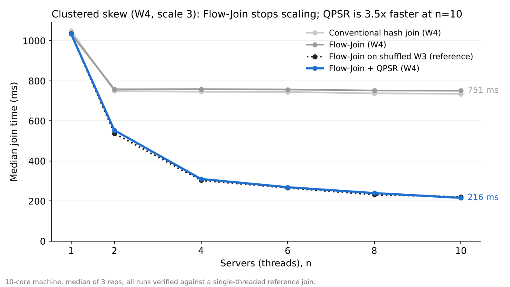
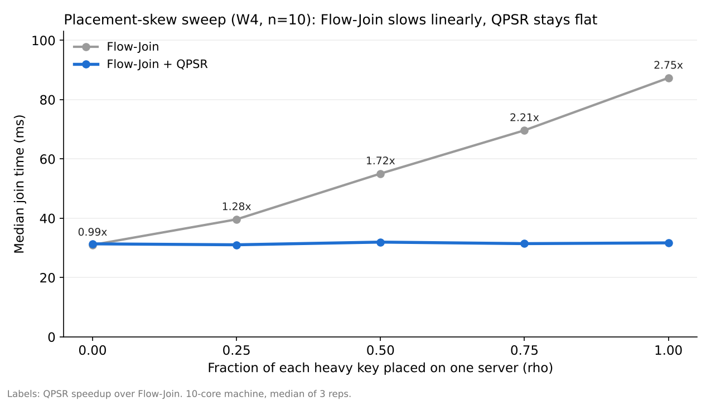
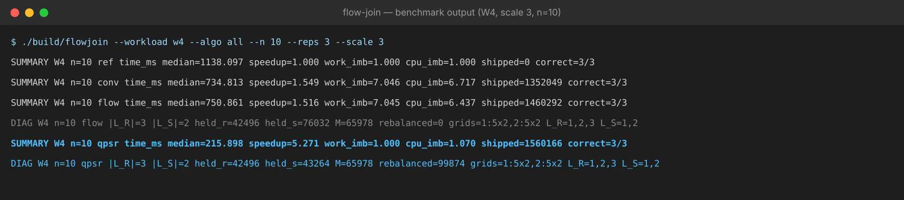

# Flow-Join with Quota-Planned Surplus Routing (QPSR)

A multi-threaded C++17 implementation of **Flow-Join** (Rödiger et al., ICDE 2016), a distributed hash join that detects heavy-hitter keys at runtime, extended with **QPSR**: a placement-aware routing decision that removes the stragglers Flow-Join suffers when heavy keys are concentrated on a few servers.

## Motivation

Flow-Join balances a heavy key by keeping its tuples on the server where they were scanned. That assumes every server already holds a fair share of each heavy key. When data is clustered (loaded by date, region or tenant), one server ends up doing most of the heavy-key work, and Flow-Join's advantage disappears: on our clustered workload it is no faster than a plain hash join and does not scale past 2 servers.

**QPSR** keeps the per-server heavy-key counts that Flow-Join's consensus step already collects (and previously discarded). Each server computes a fair quota per heavy key and sends only its **statistically significant surplus** to servers below quota. On uniform data the significance gate does not fire, so behaviour is the same as the original. The core change is about 107 lines.

## Highlights






<sub>Real benchmark output (min/max fields trimmed for width).</sub>

- **2.2–3.5× faster than Flow-Join** on clustered two-sided skew (W4) at n ≥ 4. The gain grows with servers and data size, reaching 751 → 216 ms at scale 3, n = 10.
- **Recovers shuffled-data performance:** QPSR on clustered W4 runs within about 5% of Flow-Join on the same keys shuffled (W3).
- **Correct everywhere:** 1,440 of 1,440 sweep runs and 100 of 100 ρ-sweep runs match the single-threaded reference join (count and checksum).

## Algorithms and workloads

| `--algo` | Algorithm |
|---|---|
| `ref` | Single-threaded hash join (correctness oracle and speedup baseline) |
| `conv` | Conventional distributed hash join |
| `flow` | Flow-Join: Space-Saving detection, consensus, holding, selective broadcast, SFR with `choose_grid` |
| `qpsr` | Flow-Join + Quota-Planned Surplus Routing |

| `--workload` | Data |
|---|---|
| `w1` | Uniform, no heavy keys |
| `w2` | One-sided skew (S), shuffled |
| `w3` | Two-sided skew (R and S), shuffled |
| `w4` | W3's keys with heavy keys clustered on one server each (`--rho`, default 1.0) |
| `w5` | W2's keys with heavy keys clustered (`--rho`, default 1.0) |

## Repository structure

```
src/                     algorithm headers (common, cluster, consensus, flow_exchange, phase3, workload, ...)
benchmarks/benchmark.cpp benchmark driver
benchmarks/results/      full sweep: n=<n>/W<k>/{results.csv, per_server.csv, stdout.txt} + merged files
benchmarks/results_rho/  rho sweep (rho_summary.txt)
benchmarks/benchmark_tables.xlsx  result tables: response time, speedup, scaling, efficiency
docs/images/             figures used in this README
```

## Build and run

Requirements: a C++17 compiler with pthreads (tested with g++ 13 on Linux and the default compiler on macOS), Linux or macOS.

```bash
mkdir -p build
g++ -O2 -std=c++17 -pthread -Isrc benchmarks/benchmark.cpp -o build/flowjoin
./build/flowjoin --workload w4 --algo all --n 4 --reps 3
```

Options: `--workload w1|w2|w3|w4|w5|all`, `--algo ref|conv|flow|qpsr|all`, `--n N[,N...]`, `--reps R`, `--scale F` or `--reduced`, `--rho F` (W4/W5), `--oversubscribe` (allow n > cores; timings then invalid). `--all` runs every workload and algorithm. Each run writes `results.csv` and `per_server.csv` to the current directory and prints `SUMMARY`/`DIAG` lines.

## Reproducing the benchmarks

Run from the repository root. Scale tiers: T1–T4 = 1 / 5 / 10 / 20 for W1, W2, W5 and 1 / 2 / 3 / 5 for W3, W4 (W3/W4 output grows with scale²).

**Full sweep** (n = 1, 2, 4, 6, 8, 10 × W1–W5 × 4 tiers, roughly 20–30 minutes on 10 cores):

```bash
mkdir -p build && g++ -O2 -std=c++17 -pthread -Isrc benchmarks/benchmark.cpp -o build/flowjoin && (
ROOT="$(pwd)"; OUT="$ROOT/benchmarks/results"; TMP="$(mktemp -d)"
rm -rf "$OUT"; mkdir -p "$OUT"; : > "$OUT/failures.txt"
for tier in T1:1:1 T2:5:2 T3:10:3 T4:20:5; do
  label="${tier%%:*}"; rest="${tier#*:}"; small="${rest%%:*}"; big="${rest#*:}"
  for n in 1 2 4 6 8 10; do
    for w in w1 w2 w3 w4 w5; do
      case "$w" in w3|w4) scale="$big" ;; *) scale="$small" ;; esac
      W="W${w#w}"; dir="$OUT/n=$n/$W"; mkdir -p "$dir"
      echo ">>> $label n=$n $W scale=$scale"
      rm -f "$TMP/results.csv" "$TMP/per_server.csv"
      (cd "$TMP" && "$ROOT/build/flowjoin" --workload "$w" --algo all --n "$n" --reps 3 --scale "$scale") > "$TMP/stdout.txt" 2>&1
      code=$?
      { echo "### tier=$label scale=$scale n=$n workload=$W exit=$code"; cat "$TMP/stdout.txt"; echo; } >> "$dir/stdout.txt"
      if [ "$code" -ne 0 ] || [ ! -f "$TMP/results.csv" ]; then echo "$label n=$n $W scale=$scale exit=$code" >> "$OUT/failures.txt"; continue; fi
      [ -f "$dir/results.csv" ] || echo "tier,scale,$(head -1 "$TMP/results.csv")" > "$dir/results.csv"
      awk -v p="$label,$scale" 'NR>1{print p","$0}' "$TMP/results.csv" >> "$dir/results.csv"
      [ -f "$dir/per_server.csv" ] || echo "tier,scale,n,$(head -1 "$TMP/per_server.csv")" > "$dir/per_server.csv"
      awk -v p="$label,$scale,$n" 'NR>1{print p","$0}' "$TMP/per_server.csv" >> "$dir/per_server.csv"
    done
  done
done
awk 'FNR==1&&NR!=1{next}{print}' "$OUT"/n=*/W*/results.csv > "$OUT/results.csv"
awk 'FNR==1&&NR!=1{next}{print}' "$OUT"/n=*/W*/per_server.csv > "$OUT/per_server.csv"
grep -hE '^(###|SUMMARY|DIAG)' "$OUT"/n=*/W*/stdout.txt > "$OUT/summary.txt"
rm -rf "$TMP"
if [ -s "$OUT/failures.txt" ]; then echo "DONE WITH FAILURES"; cat "$OUT/failures.txt"; else rm -f "$OUT/failures.txt"; echo "DONE: all runs correct"; fi
)
```

**ρ sweep** (W4 and W5, n = 8 and 10, run after the full sweep):

```bash
mkdir -p benchmarks/results_rho && (
cd benchmarks/results_rho
for w in w4 w5; do
  for r in 0 0.25 0.5 0.75 1.0; do
    for a in flow qpsr; do
      echo "### $w rho=$r $a"
      ../../build/flowjoin --workload "$w" --algo "$a" --n 8,10 --reps 3 --rho "$r" | grep -E 'SUMMARY|DIAG'
    done
  done
done > rho_summary.txt
rm -f results.csv per_server.csv
echo "DONE: benchmarks/results_rho/rho_summary.txt"
)
```

## Results summary

QPSR speedup over Flow-Join (median time ratio, 10-core machine):

| Workload | n = 4 | n = 10 | Remarks |
|---|---|---|---|
| W1, W2 (shuffled) | 0.98–1.00× | 0.99–1.02× | Essentially no tuples moved |
| W3 (shuffled) | 0.95–1.00× | 0.95–1.03× | 2–6% slower at larger scales) |
| **W4 (clustered, two-sided)** | **2.25–2.60×** | **2.79–3.48×** | Work imbalance 7.04 → 1.00 at n = 10 |
| W5 (clustered, one-sided) | 1.00–1.04× | 0.86–0.98× | Imbalance fixed, but extra shipping (+40–47%) outweighs it |

Full per-configuration tables (response time, speedup, scaling, efficiency, imbalance) are in `benchmarks/benchmark_tables.xlsx`.

## Limitations

- QPSR helps only when skewed tuples are expensive, i.e. they produce many outputs per tuple (the SFR path). On W5 the skewed probes are cheap, so the shipping cost dominates. A cost-aware gate is the natural next step.
- Quotas are estimated from a 1% prefix sample, so scan-order skew within a fragment is not addressed.
- Servers are threads on one machine with shared-memory mailboxes; there is no real network.

## References

W. Rödiger, S. Idicula, A. Kemper, T. Neumann. *Flow-Join: Adaptive Skew Handling for Distributed Joins over High-Speed Networks.* ICDE 2016.

## Credits

- **Shourya Pastor**, IIT Ropar, Mathematics and Computing
- **Arjun S**, IIT Ropar, Mathematics and Computing

Course: **CS301 Database Management Systems**, IIT Ropar. Instructor: **Dr. Manish Kumar**.

## License

No license has been chosen yet. Until one is added, all rights are reserved by the authors.
